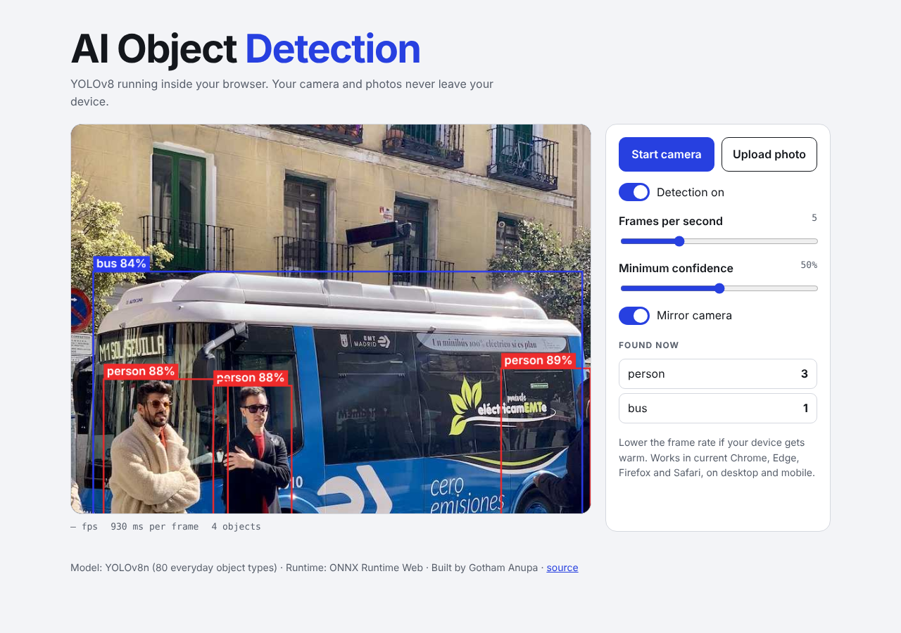

# AI Object Detection

Real-time object detection that runs **entirely in your browser**. Point your camera at something, or upload a photo, and YOLOv8 draws boxes around the 80 everyday object types it knows (people, cars, bottles, laptops, cats...). Nothing is uploaded: the model runs on your device.

## Features
- Live camera detection, or detect objects in an uploaded photo
- Detection on/off switch
- Frames-per-second slider (lower it if your device gets warm)
- Minimum-confidence slider
- Live count of each object type
- Mirror camera option
- Works on desktop and mobile, light and dark mode

## How it works
1. `export_model.py` converts YOLOv8n (PyTorch) to ONNX, a format that runs anywhere.
2. In the browser, **ONNX Runtime Web** (WebAssembly) loads `model/yolov8n.onnx` once.
3. Each frame is resized with padding to 640x640 (`letterbox`), turned into a tensor, and run through the model.
4. `detect.js` decodes the 8,400 raw candidate boxes, drops low-confidence ones, and removes duplicates with non-maximum suppression.
5. `app.js` draws the boxes on a canvas over the video.

Everything is plain HTML, CSS and JavaScript. There is no build step and no server.

## Run locally
    python serve.py          # then open http://localhost:8000
(Any static server works, but `.wasm` files need the right MIME type, which `serve.py` sets. Camera access needs `localhost` or HTTPS.)

## Deploy
Import the repository into Vercel (or GitHub Pages / Netlify). Leave the framework as "Other" and the build command empty.

## Tests
    npm install
    npm test                 # tests for letterboxing, IoU, NMS and box decoding

## Honest notes
- YOLOv8n is the smallest YOLOv8 model, chosen so it runs on phones and laptops. It is less accurate than larger models and only knows the 80 COCO object types.
- Speed depends on the device: about 0.5 to 1 second per frame on a slow cloud CPU, much faster on a modern laptop or phone. The runs here use one CPU thread.
- The model is YOLOv8n from Ultralytics (AGPL-3.0 licence). If you reuse this commercially, check that licence.
- Inspired by [w00000dy/ai-object-detection](https://github.com/w00000dy/ai-object-detection), which does browser camera detection with ml5.js. This version was written from scratch and uses a different model and runtime.

## Related
[Detector Stress Test](https://github.com/GothamAnupa/detector-stress-test) measures how blur, noise and compression hurt this same model.
